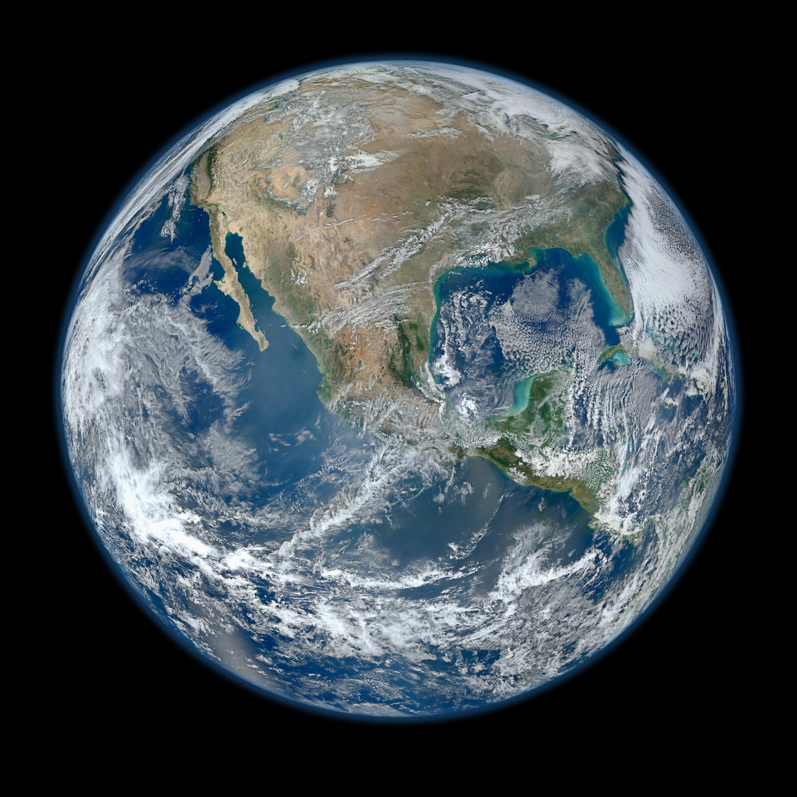
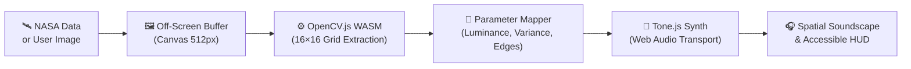

# 🌍 Earth Information Jukebox

<div align="center">

### **HEAR THE LIVING PLANET.**

**An interactive NASA-powered web application transforming Earth observation visualizations and empirical climate data into structured musical soundscapes.**

[](https://www.spaceappschallenge.org/)
[](https://earthinformationjukebox.vercel.app/)
[](https://github.com/AbdulWahid126/Earth-Information-Jukebox)

[](https://nextjs.org/)
[](https://react.dev/)
[](https://www.typescriptlang.org/)
[](https://docs.opencv.org/4.x/d5/d10/tutorial_js_root.html)
[](https://tonejs.github.io/)
[](https://tailwindcss.com/)

---

<p align="center">
  <a href="https://earthinformationjukebox.vercel.app/"><strong>🌐 Launch Live Application</strong></a> •
  <a href="#-our-solution"><strong>🎧 Dual Sonification Modes</strong></a> •
  <a href="#-getting-started"><strong>🚀 Getting Started</strong></a> •
  <a href="#-nasa-data-sources"><strong>🛰️ NASA Data Lineage</strong></a> •
  <a href="#-accessibility"><strong>♿ Accessibility</strong></a>
</p>

---



</div>

---

## 📖 Table of Contents

- [About the Project](#-about-the-project)
- [The Problem](#-the-problem)
- [Our Solution](#-our-solution)
  - [Mode A: 2D Spatial Visual Sonification](#1-mode-a-2d-spatial-visual-sonification-opencvjs-wasm)
  - [Mode B: Scientific Time-Series Sonification](#2-mode-b-scientific-time-series-sonification-nasa-gistemp-v4)
  - [Scientific Accuracy Principles](#-scientific-accuracy-principles)
- [Key Features](#-key-features)
- [How It Works](#-how-it-works)
- [Technology Stack](#-technology-stack)
- [NASA Data Sources](#-nasa-data-sources)
- [Project Structure](#-project-structure)
- [Getting Started](#-getting-started)
- [Available Routes](#-available-routes)
- [Accessibility](#-accessibility)
- [Future Roadmap](#-future-roadmap)
- [Team & Credits](#-team--credits)
- [License](#-license)

---

## 🔭 About the Project

**Earth Information Jukebox** is an open-source, client-centric data sonification laboratory developed for the **NASA Space Apps Challenge 2026**.

The platform bridges Earth system science, computer vision, and generative music by converting complex planetary observations into accessible auditory experiences in real time. Running **100% in the user's browser** without a Python backend or remote processing servers, it combines WebAssembly-powered computer vision ([OpenCV.js](https://docs.opencv.org/4.x/d5/d10/tutorial_js_root.html)) with polyphonic Web Audio synthesis ([Tone.js](https://tonejs.github.io/)).

By translating visual structures and multi-decadal temperature anomaly series into structured musical scales, Earth Information Jukebox introduces a multi-sensory way to explore global environmental change—empowering visually impaired researchers, students, and citizens to experience planetary science beyond sight alone.

---

## ⚠️ The Problem

NASA's Earth Science Division captures petabytes of planetary data, transforming raw observations into high-definition 2D colorized maps and visualizations. However, conventional dissemination creates substantial barriers:

1. **Visual Exclusivity:** Planetary observations are distributed almost exclusively as visual maps, color scales, and graphic charts. This prevents blind and low-vision researchers, educators, and students from independently analyzing geospatial patterns.
2. **Sensory Saturation:** High-density geospatial datasets often overwhelm visual perception, making it difficult to discern subtle regional contrasts or multi-decadal temporal shifts through sight alone.
3. **Passive Engagement:** Public audiences often view satellite imagery as static decorative images rather than dynamic, calibrated scientific measurements.
4. **Heavy Computing Dependencies:** Traditional sonification workflows typically rely on complex desktop environments (NumPy, SciPy, SuperCollider, or Python backends), creating high technical barriers for everyday users.

---

## 💡 Our Solution

Earth Information Jukebox resolves these challenges through an intuitive, zero-installation web environment that provides **two scientifically segregated sonification modalities**:

```
+--------------------------------------------------------------------------------------------------+
|                                    EARTH INFORMATION JUKEBOX                                     |
+--------------------------------------------------------------------------------------------------+
|                                                                                                  |
|   [ MODALITY A: SPATIAL VISUAL SONIFICATION ]        [ MODALITY B: SCIENTIFIC TIME-SERIES ]       |
|   • Source: 2D Visualization Maps / Custom Upload    • Source: NASA GISTEMP v4 Monthly CSV       |
|   • Processing: OpenCV.js WebAssembly                • Processing: TypeScript CSV Parser         |
|   • Scope: Regional visual colormap features         • Scope: 147 years of empirical anomalies   |
|   • Extraction: Luminance, Variance, Sobel Edges     • Measurement: Degrees Celsius (°C) anomaly |
|   • Audio: 16×16 Grid Spatial Polyphonic Synth       • Audio: Calibrated Pitched Anomaly Tone    |
|                                                                                                  |
+--------------------------------------------------------------------------------------------------+
```

### 1. Mode A: 2D Spatial Visual Sonification (OpenCV.js WASM)

Users can select the official **NASA GISTEMP 2025 Global Anomaly Map** or **drag and drop their own Earth observation image** (PNG, JPG, WEBP up to 10MB):

1. **Off-Screen Downsampling:** The image is drawn to an off-screen HTML5 canvas buffer and scaled proportionally to a maximum width of 512px to prevent WebAssembly memory congestion.
2. **Matrix Conversion:** OpenCV.js converts the pixel matrix into RGB, HSV, and Grayscale representations.
3. **Sobel Gradient Analysis:** Spatial edge gradients are computed using horizontal and vertical Sobel filters to identify contrast boundaries and colormap transitions.
4. **Grid Partitioning:** The visualization is divided into an $N \times M$ matrix (configurable to 8×8, 16×16, or 32×32 sectors; default 256 sectors).
5. **Feature Mapping to Sound:**
   - **Relative Luminance** ($Y = 0.299R + 0.587G + 0.114B$) $\rightarrow$ **Musical Pitch** across the active scale.
   - **Pixel Variance** (standard deviation of cell brightness) $\rightarrow$ **Low-Pass Filter Cutoff** ($500\text{ Hz} - 3500\text{ Hz}$).
   - **Horizontal Longitude Coordinate** ($x \in [0, 1]$) $\rightarrow$ **Stereo Panning** ($-85\%$ left to $+85\%$ right).
   - **Sobel Edge Density** ($> 0.15$) $\rightarrow$ **Atmospheric Texture Layer** (band-pass filtered pink noise).
   - **Map Margin Silence:** Canvas border pixels outside the planetary Robinson oval are automatically silenced as rests.

### 2. Mode B: Scientific Time-Series Sonification (NASA GISTEMP v4)

Users sonify **147 years of empirical NASA global mean temperature anomalies (1880–2026)**:

1. **Empirical CSV Ingestion:** Parses the official NASA GISS Land-Ocean Temperature Index (L-OTI) dataset directly in the browser.
2. **1951–1980 Baseline Normal:** Anomalies represent deviations relative to the internationally recognized 30-year base period.
3. **Calibrated Pitch Mapping:**
   $$\text{Frequency}(\Delta T) = 200 \times 2^{\frac{\Delta T}{1.5}}$$
   - $0.00^\circ\text{C}$ Baseline $\rightarrow 200.0\text{ Hz}$ fundamental anchor tone ($\sim\text{G}_3$).
   - Cool anomalies ($< 0^\circ\text{C}$, late 19th / early 20th century) descend into deep sub-bass registers.
   - Warm anomalies ($> 0^\circ\text{C}$, contemporary records exceeding $+1.4^\circ\text{C}$) rise into elevated melodic registers.
4. **Interactive Scrubbing & Playback:** Features an interactive canvas temperature curve with timeline scrubbing, annual/monthly granularity toggles, and tempo regulation.

---

### 🛡️ Scientific Accuracy Principles

To maintain strict scientific and technical credibility:

- **Visual Features $\neq$ Physical Temperature:** Spatial image sonification maps *colormap visual characteristics* (luminance, variance, contrast). It does not claim that pixel brightness equals in-situ physical heat.
- **True Empirical Values in Time-Series:** Time-series sonification maps *actual Celsius temperature anomaly measurements* published by NASA GISS.
- **No False Live Telemetry:** The application clearly identifies historical downloaded datasets and pre-computed visual composites. It does not falsely claim live satellite streaming or real-time orbital feeds.
- **Pure Local Execution:** Zero user imagery or audio data is ever transmitted to external servers.

---

## ✨ Key Features

| Feature Area | Implementation Details | Status |
| :--- | :--- | :--- |
| **Custom Image Upload** | Drag-and-drop zone with client-side validation for PNG, JPG, and WEBP formats up to 10 MB and 4096×4096 px. Stored in local object URLs with automatic memory cleanup. | ✅ Operational |
| **OpenCV.js WASM Engine** | Lazy-loaded 4.8 WebAssembly runtime. Computes luminance, HSV, pixel variance, and Sobel gradients with strict `cv.Mat.delete()` memory safety. | ✅ Operational |
| **16×16 Grid Overlay** | Interactive HUD visualizer supporting Wireframe, Color Swatch, Luminance, and Edge Density rendering modes with active playback reticles. | ✅ Operational |
| **Tone.js Audio Rack** | Polyphonic synthesizer array featuring AMSynth drones, FM lead voices, and noise textures. Tuned to Pentatonic, Dorian, Lydian, and Minor scales. | ✅ Operational |
| **NASA GISTEMP Time-Series** | Interactive 1880–2026 climate curve with dual-voice sonification, tempo control, timeline scrubbing, and raw CSV downloads. | ✅ Operational |
| **Hardware Keyboard Controls** | Full keyboard traversal: `Space` (Play/Pause), `S` (Stop), `M` (Mute) with high-visibility 2px solid cyan focus rings. | ✅ Operational |
| **Screen-Reader Telemetry** | Debounced `aria-live="polite"` regions announcing sector coordinates, temperature deltas, and musical frequencies. | ✅ Operational |
| **Non-Auditory Data Digest** | Structured tabular metrics and non-auditory empirical digests for deaf or hard-of-hearing users. | ✅ Operational |
| **Sea Level & Ice Dynamics** | Sentinel-6 / Jason-3 satellite altimetry dataset card. | ⏳ Planned (Future Expansion) |
| **Ocean Surface Circulation** | ECCO2 high-resolution circulation simulation card. | ⏳ Planned (Future Expansion) |

---

## 🔄 How It Works



1. **Ingest:** The user chooses the verified NASA GISTEMP 2025 anomaly map, the multi-decadal CSV dataset, or uploads their own satellite image.
2. **Buffer:** The asset is loaded into memory and scaled on an off-screen HTML5 canvas buffer to 512px.
3. **Analyze:** OpenCV.js executes color space conversion, edge detection, and grid segmentation directly in the browser's WebAssembly heap.
4. **Map:** Extracted statistical vectors (or empirical time-series values) are normalized and mapped to musical pitch, filter cutoff, and stereo spatialization.
5. **Synthesize:** Tone.js dispatches events across polyphonic synths synchronized with the audio clock.
6. **Experience:** The user hears the soundscape while inspecting the interactive 16×16 grid overlay and accessible telemetry feeds.

---

## 🛠️ Technology Stack

Earth Information Jukebox is built with a focused, modern Jamstack architecture:

- **Core Framework:** [Next.js](https://nextjs.org/) `16.4.6` (App Router, Turbopack, Partial Prerendering)
- **UI Runtime:** [React](https://react.dev/) `19.3.0`
- **Language:** [TypeScript](https://www.typescriptlang.org/) `5.x` (Strict static typing)
- **Styling:** [Tailwind CSS](https://tailwindcss.com/) `4.3.3` with custom NASA Mission Control / DAW dark theme
- **Computer Vision:** [OpenCV.js](https://docs.opencv.org/4.x/d5/d10/tutorial_js_root.html) `4.8.x` (WebAssembly compilation)
- **Audio Synthesis:** [Tone.js](https://tonejs.github.io/) `15.1.22` & W3C Web Audio API
- **Animation & HUD:** [Framer Motion](https://www.framer.com/motion/) `14.14.0`
- **Iconography:** [Lucide React](https://lucide.dev/) `1.73.0`
- **Deployment & Edge:** [Vercel](https://vercel.com/) (Automated CI/CD, Edge Network)

---

## 🛰️ NASA Data Sources

All scientific data and visualization maps are sourced from official NASA public-domain archives:

| Dataset | Provider / Laboratory | SVS ID / Reference | Climatological Baseline | Measurement Units |
| :--- | :--- | :--- | :--- | :--- |
| **GISTEMP v4 2025 Map** | NASA Goddard Institute for Space Studies (GISS) / SVS | [SVS #5603](https://svs.gsfc.nasa.gov/5603/) | 1951–1980 Base Period | °C Temperature Anomaly (Robinson Projection) |
| **GISTEMP v4 Monthly Series** | NASA Goddard Institute for Space Studies (GISS) | [GISS Data Portal](https://data.giss.nasa.gov/gistemp/) | 1951–1980 Base Period | °C Monthly & Annual Planetary Mean |
| **GISTEMP v4 Data Directory** | NASA GISS Table Data Downloads | [GISTEMP Table Data](https://data.giss.nasa.gov/gistemp/data_v4.html) | 1951–1980 Base Period | Land-Ocean Temperature Index (L-OTI) |

### Academic Citations

- **GISTEMP Uncertainty Ensemble:**  
  Lenssen, N., G.A. Schmidt, M. Hendrickson, P. Jacobs, M. Menne, and R. Ruedy (2024). *A GISTEMPv4 observational uncertainty ensemble*. J. Geophys. Res. Atmos., 129, no. 17, e2023JD040179. [doi:10.1029/2023JD040179](https://doi.org/10.1029/2023JD040179).
- **Colormap Specification:**  
  Crameri, F. (2018). *Scientific colour maps: "vik" diverging palette*. Zenodo. [doi:10.5281/zenodo.1243862](https://doi.org/10.5281/zenodo.1243862).

---

## 📁 Project Structure

```
Earth-Information-Jukebox/
├── .gitignore                      # Git exclusion rules (anchored /lib/ rule)
├── README.md                       # Project overview & documentation
├── docs/                           # Architecture, PRD, and scientific specifications
│   ├── ARCHITECTURE.md             # System architecture & pipeline designs
│   ├── DESIGN.md                   # UI/UX, mission control theme tokens & typography
│   ├── NASA_DATA_SOURCES.md        # Provenance, citations & calibration registry
│   ├── PRD.md                      # Product Requirements Document
│   ├── RULES.md                    # Scientific integrity & coding directives
│   └── TASKS.md                    # Implementation sprint logs & milestones
└── frontend/                       # Next.js 16 client-side web application
    ├── public/
    │   └── assets/
    │       ├── datasets/           # Verified NASA CSV data files (GISTEMP monthly)
    │       ├── opencv/             # Browser-patched OpenCV.js WebAssembly binary
    │       └── visualizations/     # Official NASA 1080p maps & preview thumbnails
    ├── src/
    │   ├── app/                    # Next.js App Router routes
    │   │   ├── layout.tsx          # Root layout with mission control navigation & footer
    │   │   ├── page.tsx            # Homepage with interactive architecture overview
    │   │   ├── explore/page.tsx    # Earth Explorer dataset catalog & telemetry
    │   │   ├── studio/page.tsx     # Audio workstation & dual sonification bay
    │   │   └── about/page.tsx      # Scientific documentation & evaluator walkthrough
    │   ├── components/
    │   │   ├── explorer/           # Dataset cards, detail viewports & analysis panels
    │   │   ├── home/               # Hero, workflow, features & accessibility sections
    │   │   ├── layout/             # Responsive navigation bar & mission control footer
    │   │   ├── sonification/       # Audio control bar, scale mappers & text summaries
    │   │   ├── studio/             # Studio workstation & ImageUploadZone component
    │   │   └── timeseries/         # Interactive canvas chart & climate sonification
    │   ├── hooks/                  # Domain hooks (useImageProcessor, useSonificationEngine)
    │   ├── lib/                    # Core computational pipelines
    │   │   ├── cv/                 # OpenCV loader, canvas buffers & grid analyzer
    │   │   ├── data/               # Robust browser CSV parser
    │   │   ├── nasa/               # Verified dataset metadata registry
    │   │   └── sonification/       # Tone.js synthesis engine, scales & parameter mappers
    │   └── types/                  # Strict TypeScript definitions (CV, Audio, TimeSeries)
    ├── package.json                # Project dependencies and build scripts
    ├── next.config.ts              # Next.js configuration
    └── tsconfig.json               # Path aliases (@/* -> ./src/*)
```

---

## 🚀 Getting Started

Follow these steps to run the application locally on your machine.

### Prerequisites

- [Node.js](https://nodejs.org/) (Version `18.18.0` or higher; `20.x` recommended)
- `npm` (Included with Node.js)
- [Git](https://git-scm.com/)

### Installation & Local Setup

```powershell
# 1. Clone the repository
git clone https://github.com/AbdulWahid126/Earth-Information-Jukebox.git

# 2. Navigate to the frontend directory
cd Earth-Information-Jukebox/frontend

# 3. Install project dependencies
npm.cmd install

# 4. Start the local development server
npm.cmd run dev
```

Open your browser and navigate to **`http://localhost:3000`** to experience the application.

### Building for Production

```powershell
# Build the production-optimized static deployment
npm.cmd run build

# Start the production server locally
npm.cmd run start
```

---

## 🗺️ Available Routes

| Route | Viewport Title | Description |
| :--- | :--- | :--- |
| **`/`** | **Mission Control Home** | Editorial hero section, interactive Earth visualizer, 4-stage pipeline breakdown, featured Earth systems, and accessibility pillars. |
| **`/explore`** | **Earth Explorer Catalog** | Browse verified NASA Earth observation datasets, review sensor metadata and citations, inspect projection specs, and download raw CSV data. |
| **`/studio`** | **Synthesizer Workstation** | Full digital audio workstation featuring dual-modality sonification: Scientific Time-Series mode (1880–2026), 2D Spatial Map mode, and Custom Image Upload. |
| **`/about`** | **Scientific Documentation** | Detailed briefing covering project goals, scientific attribution, zero-backend architecture guarantees, and evaluator walkthroughs. |

---

## ♿ Accessibility

Earth Information Jukebox is engineered with universal accessibility as a core design priority:

- **Hardware Keyboard Navigation:** Full keyboard navigation support across the application. Audio playback supports global shortcuts:
  - `Space` $\rightarrow$ Toggle Play / Pause
  - `S` $\rightarrow$ Stop Playback and Return to Origin
  - `M` $\rightarrow$ Mute / Unmute Master Gain
- **Visible Focus Traversal:** High-contrast 2px solid cyan (`#00E5FF`) focus rings on all interactive buttons, sliders, and form elements.
- **Screen-Reader Telemetry:** Debounced `aria-live="polite"` regions announce active sector coordinates, temperature anomalies, and active musical frequencies without speech clutter.
- **Non-Auditory Data Digests:** The `<NonAudioFeatureSummary />` component provides formatted tabular summaries and empirical digests for deaf and hard-of-hearing users.
- **Reduced-Motion Consideration:** Animations respect system-level prefers-reduced-motion preferences.

> *Note: While engineered with accessibility principles in mind, formal third-party WCAG 2.1 AA audit certification has not yet been conducted.*

---

## 🔮 Future Roadmap

- [ ] **Sentinel-6 Radar Altimetry Integration:** Implement sub-bass sonification for global sea surface height anomalies and polar ice meltwater displacement.
- [ ] **ECCO2 Ocean Circulation Synthesis:** Arpeggiated kinetic flow sonification derived from oceanic boundary currents and mesoscale eddy simulations.
- [ ] **Web MIDI Controller Support:** Enable external MIDI hardware faders and keyboards to control sonification parameters in the Studio.
- [ ] **Multi-Spectral Satellite Band Ingestion:** Direct comparison of true-color, false-color infrared, and thermal infrared spectral bands across identical coordinates.

---

## 👥 Team & Credits

- **NASA Space Apps Challenge 2026 Submission**
- **Project Creator & Developer:** **Abdul Wahid** ([@AbdulWahid126](https://github.com/AbdulWahid126))
- **Scientific Data Courtesy:**
  - NASA Goddard Institute for Space Studies (GISS)
  - NASA Scientific Visualization Studio (SVS)
  - NOAA National Centers for Environmental Information (NCEI)
  - Estimating the Circulation and Climate of the Ocean (ECCO) Consortium

---

## 📄 License

Licensing terms for this project have not yet been specified. Please refer to the repository owner for permissions and reuse inquiries. All NASA imagery and data products are in the public domain or used under NASA open-data guidelines.
