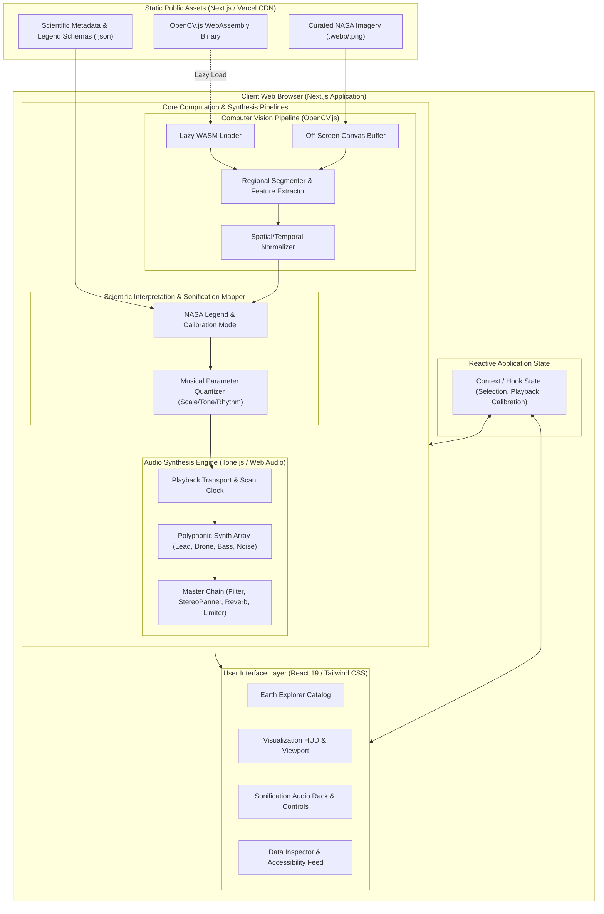
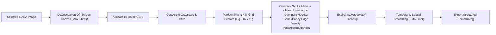
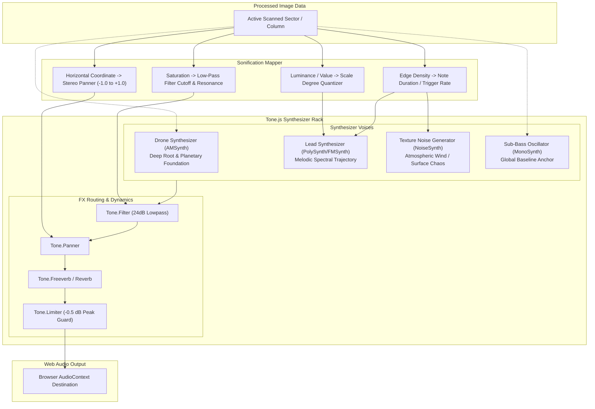
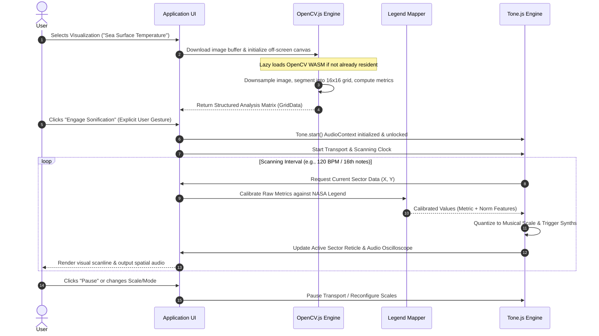

# System Architecture Document
## Earth Information Jukebox

**Author / Lead Architect:** Lead Software Architect  
**Project Owner / Developer:** Solo Developer  
**Status:** Approved Technical Architecture  
**Target Platform:** Next.js (Client-Centric Jamstack) / Vercel Edge Hosting

---

## 1. System Architecture Overview

The Earth Information Jukebox is architected as an autonomous, 100% client-side web application. It operates entirely within the user's browser, eliminating the operational complexity, hosting costs, and latency of a Python scientific server or cloud database.



---

## 2. Technology Stack

| Layer | Chosen Technology | Version / Spec | Justification & Architectural Role |
| :--- | :--- | :--- | :--- |
| **Framework** | Next.js (App Router) | `16.4.x` | Modern React framework with high-efficiency static optimization, edge routing, and clean component isolation. |
| **UI Library** | React | `19.3.x` | Latest stable React runtime leveraging modern hooks and concurrent rendering capabilities. |
| **Language** | TypeScript | `5.x` | Enforces strict compile-time typing across computer vision matrix structures, audio parameters, and scientific metadata. |
| **Styling** | Tailwind CSS | `4.3.x` | Utility-first, zero-runtime CSS engine configured with a custom NASA Mission Control / DAW dark theme. |
| **Computer Vision** | OpenCV.js | `4.8.x+` (WASM) | Industrial-grade computer vision compiled to WebAssembly for client-side matrix manipulations, color conversions, and edge detection. |
| **Audio Synthesis** | Tone.js | `15.1.x` | Web Audio framework offering robust scheduling (Transport), polyphonic synthesis, audio effect chains, and scale-tuning utilities. |
| **Animation / HUD** | Framer Motion | `14.14.x` | High-performance hardware-accelerated animations for scanning reticles, audio level meters, and UI state transitions. |
| **Icons** | Lucide React | `1.73.x` | Clean, standardized SVG icons for media controls, planetary filters, and mission telemetry. |
| **Hosting & CI/CD** | Vercel | Global Edge | Automated zero-configuration Git-integrated static deployments with HTTP/2 and asset edge caching. |

---

## 3. Frontend Architecture

The frontend follows a decoupled modular architecture organized into four functional layers:

1. **Presentation Components (`src/components/*`):**
   - Presentational UI components designed with strict separation from business logic.
   - Built to simulate hardware instrumentation: rack mounts, digital rotary knobs, LED status meters, and oscilloscope displays.
2. **Custom Domain Hooks (`src/hooks/*`):**
   - `useOpenCV`: Manages the asynchronous lazy loading of the OpenCV.js script and its lifecycle state (`idle`, `loading`, `ready`, `error`).
   - `useImageProcessor`: Handles off-screen canvas rendering, frame extraction, downscaling, and triggering OpenCV analysis.
   - `useSonificationEngine`: Orchestrates Tone.js AudioContext activation, voice dispatch, note scheduling, and volume/tempo controls.
   - `useScanTransport`: Coordinates the visual playhead position with the audio scheduling loop.
3. **Core Services & Pure Utilities (`src/lib/*`):**
   - Pure, stateless TypeScript modules handling mathematical scaling, color transforms, legend interpolation, and audio-frequency conversions.
4. **Data Repositories (`src/data/*`):**
   - Static schemas, NASA dataset catalog definitions, and verified scientific calibration tables.

---

## 4. Computer Vision Processing Pipeline (OpenCV.js)

To prevent browser UI freezes, memory exhaustion, and audio stutter, the computer vision engine processes images using controlled regional aggregation rather than unconstrained per-pixel operations.



### Key CV Pipeline Rules:
1. **Lazy Initialization:** OpenCV.js (`opencv.js`) is never loaded on the homepage. It is fetched dynamically only when the user opens the Visualization Workspace.
2. **Buffer Downsampling:** Source images are loaded onto an off-screen HTML5 `CanvasRenderingContext2D` and normalized to a uniform processing size (e.g., $512 \times 512$ or $640 \times 360$) before conversion to an OpenCV `cv.Mat`.
3. **Grid-Based Statistical Aggregation:** The image is divided into a discrete $N \times M$ grid (default: $16 \times 16$ or $32 \times 32$ sectors). For each sector, the pipeline extracts:
   - **Luminance:** Normalized brightness $\in [0, 1]$.
   - **Hue & Saturation:** Mean HSV coordinates representing visual spectral distribution.
   - **Edge Density:** Gradient magnitude using Sobel or Canny filters $\in [0, 1]$, representing spatial boundaries (fronts, coastlines, wildfires).
   - **Roughness / Variance:** Standard deviation of pixel values within the cell.
4. **WASM Heap Garbage Collection:** JavaScript garbage collection does not clean up OpenCV.js C++ objects. Every allocated `cv.Mat`, `cv.Rect`, or `cv.Scalar` must be explicitly freed in a `try...finally` block via `.delete()`.

### Implemented Phase 4 CV Module Architecture:
- `frontend/src/types/cv.ts`: Strongly typed data contracts for color coordinates (`ColorRGB`, `ColorHSV`), grid coordinates (`SectorCoordinates`), regional metrics (`RegionalVisualFeatures`), grid configuration (`GridConfig`), and complete analysis results (`GridAnalysisResult`).
- `frontend/src/lib/cv/cvTypes.ts`: Strict TypeScript definitions for the OpenCV.js WASM runtime API (`CVMat`, `CVRect`, `CVSize`, `CVScalar`, `OpenCVRuntime`).
- `frontend/src/lib/cv/opencvLoader.ts`: Singleton lazy loader with dynamic script injection (`/assets/opencv/opencv.js`). Resolves two critical bundler runtime pitfalls:
  1. *AMD Loader Conflict:* Patched `opencv.js` line 2 to disable `define.amd` branching, forcing browser window global attachment (`window.cv`).
  2. *Emscripten `.then` Trap:* Deletes `(window.cv as any).then` prior to resolving the promise to avoid ECMAScript promise recursion microtask infinite loops.
- `frontend/src/lib/cv/imageLoader.ts`: Offscreen canvas downsampler scaling arbitrary NASA rasters to an exact max width of 512px ($512 \times 288$ for 16:9 HD) while avoiding canvas tainting on local relative assets.
- `frontend/src/lib/cv/gridAnalyzer.ts`: High-performance sector extraction computing mean RGB, HSV, Rec. 601 luminance, standard deviation variance (`data64F` for `CV_64FC1`), Sobel gradient edge density, and background canvas margin classification (`isLikelyBackground`). Guarantees deterministic `.delete()` cleanup on all temporary matrices in `finally` blocks.
- `frontend/src/hooks/useImageProcessor.ts`: React hook managing OpenCV initialization lifecycle, loading progress, canvas raster extraction, grid analysis execution, sector selection, and HUD visualizer state.
- `frontend/src/components/explorer/GridOverlayVisualizer.tsx`: Interactive SVG/Canvas HUD overlay rendering Wireframe, Color, Luminance, and Edge Density heatmaps with interactive sector inspection reticles.
- `frontend/src/components/explorer/ImageAnalysisPanel.tsx`: NASA mission-control analysis panel with configurable grid resolution (8×8, 16×16, 32×32), live telemetry stats, sector inspector, and scientific disclaimer notice.

---

## 5. Scientific Data Interpretation & Legend Mapping

> **CRITICAL ARCHITECTURAL DIRECTIVE:** Never assume image pixel color directly corresponds to scientific values without calibration. An image is a 2D RGB visualization of underlying sensor measurements that has been run through a specific NASA colormap.

### Legend Mapping Architecture
Each curated NASA visualization is paired with a verified **Visualization Metadata Schema** defining:
1. **Colormap Specification:** The NASA legend type (e.g., Turbo, Viridis, Thermal, Blue-to-Red, or Crameri *vik*).
2. **Physical Metric Bounds:** The physical measurement and its verified unit range (e.g., Temperature Anomaly in ${^\circ}\text{C}$ relative to the 1951–1980 baseline).
3. **Calibration Lookup Table (LUT):** Mathematical reference points connecting RGB/HSV values to verified metric values.
4. **Confidence & Approximation Flags:** Clear metadata attributes indicating whether a metric represents an exact physical reading, an interpolated value, or an uncalibrated optical proxy (e.g., cloud optical thickness visual proxy).
5. **Modality Separation (Spatial vs. Time-Series):** Clear architectural separation between 2D spatial raster imagery (processed via OpenCV.js) and 1D scalar time-series tables (e.g., GISTEMP monthly means CSV). Time-series data must never be treated as spatial grid cells. Full specifications are maintained in `docs/NASA_DATA_SOURCES.md`.

---

## 6. Sonification Processing Pipeline & Tone.js Architecture

The sonification engine translates normalized scientific and visual features into harmonic, multi-timbral audio.



### Multi-Voice Audio Architecture:
1. **Root / Drone Voice (`Tone.AMSynth`):**
   - Generates sustained, resonant ambient chords grounded in the foundational global baseline of the dataset.
   - Modulated slowly to evoke deep planetary scale.
2. **Melodic Lead Voice (`Tone.PolySynth` with `Tone.Synth`):**
   - Translates regional luminance and calibrated temperature/density into discrete musical notes.
   - Quantized strictly to user-selected musical scales (e.g., Minor Pentatonic, Dorian, Lydian) to prevent dissonance.
3. **Atmospheric Texture Voice (`Tone.NoiseSynth`):**
   - High spatial edge density (roughness, fronts, turbulent boundaries) injects soft, band-pass-filtered white or pink noise simulating atmospheric friction, ocean spray, or solar wind.
4. **Stereo Spatialization (`Tone.Panner`):**
   - The playhead's horizontal position maps directly to the stereo field ($x = 0 \to -1.0$ [full left], $x = 1 \to +1.0$ [full right]), providing spatial acoustic orientation.
5. **Peak Protection & Limiting (`Tone.Limiter`):**
   - A master limiter clamped at $-0.5\text{ dB}$ ensures that rapid parameter changes or overlapping voices never produce harsh clipping or digital distortion.

### Implemented Phase 5 Sonification Module Architecture:
- `frontend/src/types/sonification.ts`: Type system defining `PlaybackStatus`, `MusicalScaleId`, `MusicalScaleDefinition`, `TraversalMode`, `SonificationMappingConfig`, `SonificationEvent`, and `SonificationTelemetry`.
- `frontend/src/lib/sonification/scales.ts`: Scale catalogs (Major Pentatonic, Minor Pentatonic, Dorian, Lydian, Aeolian/Natural Minor), note-to-frequency mathematical converters ($f = 440 \cdot 2^{(\text{midi}-69)/12}$), and monotonic scale degree quantizers.
- `frontend/src/lib/sonification/parameterMapper.ts`: Deterministic mapper generating `SonificationEvent[]` timelines from `GridAnalysisResult`. Orders sectors via longitude sweeps (`column_sweep`), latitude scans (`raster`), or polar zigzags (`boustrophedon`); maps luminance to pitch, variance to lowpass filter cutoff ($500\text{ Hz} - 3500\text{ Hz}$), horizontal position to stereo panning ($-0.85$ to $+0.85$), and flags white canvas margins as rests.
- `frontend/src/lib/sonification/toneEngine.ts`: Client-side audio rack managing Web Audio lifecycle, user gesture unlock (`Tone.start()`), signal routing (`leadSynth`, `droneSynth`, `noiseSynth` $\to$ `filter` $\to$ `panner` $\to$ `reverb` $\to$ `volume` $\to$ `limiter` $\to$ destination), step-sequenced `Tone.Transport.scheduleRepeat`, and sample-accurate UI synchronizer (`Tone.Draw.schedule`). Ensures clean disposal and cancelation of transport schedules on stop/unmount.
- `frontend/src/hooks/useSonificationEngine.ts`: React hook coordinating playback state, mapping parameters, keyboard shortcuts (Space for Play/Pause, S for Stop, M for Mute), and throttled screen-reader announcements (`aria-live="polite"`).
- `frontend/src/components/sonification/SonificationControlBar.tsx`: Mission-control playback station with transport buttons, active pitch telemetry meter, progress bar, scale/speed/mode dropdowns, volume slider, and voice toggles.
- `frontend/src/components/sonification/SonificationMappingExplainer.tsx`: Transparent scientific guide detailing the transformation of visual features into musical parameters.
- `frontend/src/components/sonification/NonAudioFeatureSummary.tsx`: Accessible empirical digest highlighting data coverage, luminance ranges, thermal front complexity, and geographic sector extrema for users who are deaf or hard-of-hearing.
- `frontend/src/components/studio/StudioWorkstation.tsx`: Professional DAW and mission-control laboratory console hosting planetary dataset switching and real-time sonification controls.

### Implemented Phase 6 Time-Series Module Architecture:
- `frontend/src/types/timeSeries.ts`: Data definitions for `MonthlyAnomalyRecord`, `AnnualAnomalyRecord`, `GistempParsedData`, `GistempDatasetSummary`, `TimeSeriesSonificationEvent`, and `TimeSeriesSonificationConfig`.
- `frontend/src/lib/data/gistempCsvParser.ts`: Resilient client-side CSV parser processing NASA GISS Land-Ocean Temperature Index (`GLB.Ts+dSST.csv`, 1880–2026). Strictly enforces `***` as `null` missing data (never zero), validates 147 years of records, and generates filtered annual and monthly timelines.
- `frontend/src/lib/sonification/timeSeriesMapper.ts`: Empirical mathematical mapper translating Celsius anomalies into musical parameters. Anchors the 1951–1980 baseline ($0.00^\circ\text{C}$) at C4 ($261.6\text{ Hz}$), maps negative anomalies to lower octaves (C2–A3) with warm lowpass filtering ($500\text{ Hz}$), and maps positive anomalies to upper registers (C4–C6) with bright harmonic opening ($3600\text{ Hz}$).
- `frontend/src/lib/sonification/timeSeriesAudioEngine.ts`: Dedicated Web Audio engine with `Tone.PolySynth` lead, `Tone.AMSynth` baseline drone anchor (C2), dynamic low-pass filter, reverb, master limiter, and sample-accurate `Tone.Draw` frame synchronization.
- `frontend/src/hooks/useTimeSeriesSonification.ts`: React hook managing asynchronous CSV loading, timeline event synthesis, playback state (Play/Pause/Resume/Stop/Seek), timeline granularity toggles, and throttled live screen-reader announcements.
- `frontend/src/components/timeseries/TimeSeriesChart.tsx`: High-performance, zero-dependency SVG visualization rendering 1880–2026 temperature anomalies with zero baseline, colored anomaly bars (blue cold / amber-red warm), hover crosshair probe, and live playback playhead.
- `frontend/src/components/timeseries/TimeSeriesSonificationPanel.tsx`: Full mission-control console integrating the SVG chart, dual granularity toggles (Annual vs Monthly), audio transport faders, and keyboard shortcuts.
- `frontend/src/components/timeseries/TimeSeriesExplainer.tsx`: Transparent scientific guide detailing the physical meaning of anomalies, the 1951–1980 baseline, and pitch mapping rules.
- `frontend/src/components/timeseries/TimeSeriesDataSummary.tsx`: Accessible non-auditory empirical digest highlighting all-time warmth (+1.28 °C in 2024), all-time cold (-0.49 °C in 1909), and decadal warming trends.

---

## 7. Data Flow Between Modules



---

## 8. Suggested Folder Structure

The project maintains clean modularity under the `frontend/` directory:

```text
frontend/
├── public/
│   ├── assets/
│   │   ├── opencv/
│   │   │   └── opencv.js              # Lazy-loaded OpenCV WASM runtime
│   │   └── visualizations/            # Curated NASA imagery
│   │       ├── sst-global.webp        # Sea Surface Temperature
│   │       ├── ndvi-vegetation.webp   # Biosphere Vegetation Index
│   │       ├── sea-ice-extent.webp    # Polar Cryosphere Extent
│   │       └── fires-aerosol.webp     # FIRMS Thermal Anomalies
│   └── favicon.ico
├── src/
│   ├── app/                           # Next.js App Router
│   │   ├── layout.tsx                 # Root layout & NASA metadata
│   │   ├── page.tsx                   # Homepage & Mission Briefing
│   │   ├── explorer/
│   │   │   └── page.tsx               # Earth Explorer Catalog
│   │   ├── workspace/
│   │   │   └── page.tsx               # Main Sonification Laboratory HUD
│   │   └── globals.css                # Global Tailwind CSS definitions
│   ├── components/
│   │   ├── common/                    # Reusable primitives (Buttons, Sliders, Badges)
│   │   ├── layout/                    # Header, Footer, MissionBar, Navigation
│   │   ├── explorer/                  # CatalogGrid, DatasetCard, FilterBar
│   │   ├── workspace/                 # ImageCanvas, ScanReticle, LegendOverlay
│   │   ├── audio/                     # AudioRack, ScaleSelector, VolumeKnob, Oscilloscope
│   │   └── telemetry/                 # DataInspector, AccessibilityReadout, MetricBadge
│   ├── hooks/
│   │   ├── useOpenCV.ts               # Lazy-loading and WASM state hook
│   │   ├── useImageProcessor.ts       # CV extraction pipeline hook
│   │   ├── useSonificationEngine.ts   # Tone.js synthesis and playback hook
│   │   └── useScanTransport.ts        # Playhead clock & synchronization hook
│   ├── lib/
│   │   ├── cv/
│   │   │   ├── cvTypes.ts             # Low-level OpenCV typing
│   │   │   ├── gridAnalyzer.ts        # Segmentation & feature extraction algorithms
│   │   │   └── smoothing.ts           # Exponential moving average & filter utils
│   │   ├── sonification/
│   │   │   ├── scales.ts              # Musical scales, frequency conversions, tuning
│   │   │   ├── synthRack.ts           # Tone.js instrument definitions & audio routing
│   │   │   └── mappings.ts            # Metric-to-musical parameter transformation functions
│   │   ├── nasa/
│   │   │   ├── legendCalibration.ts   # RGB-to-scientific metric calculation
│   │   │   └── datasets.ts            # Curated NASA dataset records and source metadata
│   │   └── utils.ts                   # Generic helper utilities
│   └── types/
│       ├── visualization.ts           # Dataset schemas and metadata interfaces
│       ├── cv.ts                      # Analysis outputs and sector metric interfaces
│       └── audio.ts                   # Audio parameter and synth configuration interfaces
├── package.json
├── tsconfig.json
└── tailwind.config.ts
```

---

## 9. TypeScript Interfaces for Processing Results

### 9.1 NASA Visualization & Scientific Metadata
```typescript
export type EarthSystemCategory = 'Atmosphere' | 'Biosphere' | 'Cryosphere' | 'Hydrosphere';

export interface LegendRange {
  minPhysicalValue: number;
  maxPhysicalValue: number;
  unit: string;
  isCalibrated: boolean; // false indicates visual proxy rather than direct metric
  notes: string;
}

export interface NASAVisualizationDataset {
  id: string;
  title: string;
  subtitle: string;
  category: EarthSystemCategory;
  sensor: string; // e.g., "MODIS / Terra & Aqua", "VIIRS / Suomi NPP"
  mission: string; // e.g., "Earth Observing System"
  temporalRange: string; // e.g., "September 2024 Composite"
  imagePath: string;
  thumbnailPath: string;
  sourceUrl: string; // Direct link to NASA Worldview / Earth Observatory
  legend: LegendRange;
  description: string;
  scientificContext: string;
}
```

### 9.2 Computer Vision Extraction Results
```typescript
export interface SectorCoordinates {
  colIndex: number;
  rowIndex: number;
  normalizedX: number; // 0.0 (left) to 1.0 (right)
  normalizedY: number; // 0.0 (top) to 1.0 (bottom)
  pixelX: number;
  pixelY: number;
  width: number;
  height: number;
}

export interface SectorMetrics {
  coordinates: SectorCoordinates;
  luminance: number;       // 0.0 (black) to 1.0 (pure white)
  meanColor: {
    r: number;
    g: number;
    b: number;
    h: number; // 0 to 360
    s: number; // 0 to 1.0
    v: number; // 0 to 1.0
  };
  edgeDensity: number;     // 0.0 (smooth gradient) to 1.0 (high spatial contrast)
  roughnessVariance: number; // Standard deviation of pixel luminance
  estimatedPhysicalValue?: number; // Calculated via NASA legend mapping if calibrated
}

export interface GridAnalysisResult {
  datasetId: string;
  gridDimensions: {
    columns: number;
    rows: number;
    totalSectors: number;
  };
  imageDimensions: {
    width: number;
    height: number;
  };
  globalMetrics: {
    averageLuminance: number;
    averageEdgeDensity: number;
    dominantHue: number;
  };
  sectors: SectorMetrics[][]; // 2D array [row][column]
  processedTimestamp: number;
}
```

### 9.3 Sonification Mapping Parameters
```typescript
export type MusicalScaleName = 
  | 'c_minor_pentatonic' 
  | 'd_dorian' 
  | 'f_lydian' 
  | 'a_aeolian' 
  | 'planetary_chromatic';

export type ScanningMode = 
  | 'horizontal_sweep' 
  | 'vertical_sweep' 
  | 'region_probe' 
  | 'global_ambient';

export interface SonificationFrameParameters {
  sector: SectorMetrics;
  pitchNote: string;       // e.g., "C4", "Eb4", "G4"
  frequencyHz: number;
  droneRootHz: number;
  cutoffFrequencyHz: number; // 200 Hz to 12000 Hz
  resonanceQ: number;
  noiseLevelDb: number;    // -60 dB to -10 dB
  stereoPan: number;       // -1.0 (left) to +1.0 (right)
  masterGainDb: number;
  triggerDurationSec: number;
}
```

---

## 10. Error Handling Architecture

The application adopts resilient, graceful degradation patterns across all computational stages:

1. **WASM / OpenCV Load Failure:**
   - If OpenCV.js fails to download (e.g., restricted network, timeout), the UI displays a clean NASA Mission Alert with retry capability and gracefully falls back to a lightweight standard HTML5 Canvas pixel sampler, preserving core sonification functionality.
2. **Web Audio Permission & Autoplay Policy:**
   - Browser policies forbid unprompted audio playback. The audio context state is tracked (`suspended`, `running`, `closed`). If an invocation occurs before interaction, the user is presented with an intuitive "Acoustic System Standby — Press Space or Click Engaged" prompt.
3. **Memory Overflow Prevention:**
   - A global cleanup hook ensures that whenever a user navigates between views or loads a new image, all active Tone.js loops are suspended and allocated OpenCV matrices are explicitly discarded.
4. **Invalid Image Bounds / Malformed Data:**
   - Fallback synthetic test patterns (e.g., standard calibration bars) are provided internally should an image asset fail to decode.

---

## 11. Performance Considerations

- **Frame Budget:** UI animations run on the GPU via CSS transforms and Framer Motion. Image analysis is detached from the render loop and executed once per image selection or scan sweep update.
- **Worker / Batching Consideration:** For the MVP, downscaling the image to $512\text{px}$ and segmenting into a $16 \times 16$ grid ($256$ cells) takes less than $12\text{ms}$ on modern CPUs inside OpenCV.js WASM, which comfortably fits inside a single task without requiring multi-threaded Web Workers. *Decision for research: If scaling to $64 \times 64$ grids in future releases, offload OpenCV to a dedicated Web Worker.*
- **Tone.js Transport Scheduling:** Audio notes are scheduled ahead using `Tone.Transport.scheduleRepeat()` rather than naive `setInterval()`, ensuring sub-millisecond jitter-free acoustic playback regardless of UI re-renders.

---

## 12. Browser Compatibility Considerations

- **WebAudio & AudioContext:** Fully compatible with Chromium $90+$, Firefox $88+$, and Safari $14.1+$. iOS Safari requires the standard user-tap unlock sequence, which is natively handled by the app's "Engage Sonification" button.
- **WebAssembly (WASM):** OpenCV.js requires standard WebAssembly MVP support, available across $>97\%$ of active global browsers.
- **Off-Screen Rendering:** Off-screen canvas buffering utilizes standard HTML5 `<canvas>` elements to ensure uniform cross-browser canvas API behavior.
